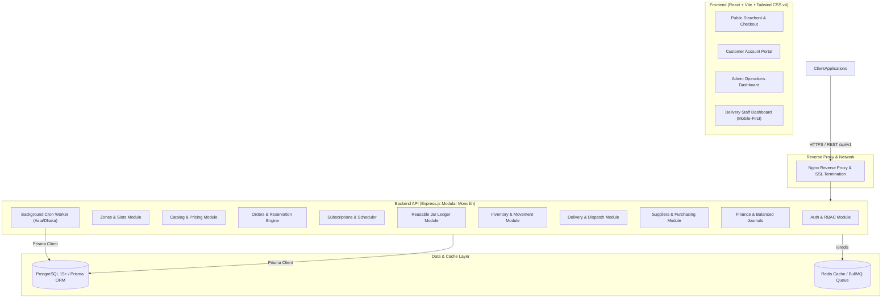

# 02 — System Architecture: AquaFlow

> Maintained by `iron_man` and `edith`.

---

## 1. High-Level Architecture Overview
AquaFlow is structured as a modular full-stack web platform consisting of a unified React frontend and a modular Express.js backend with PostgreSQL and Redis.

---

## 2. Component Boundaries & Responsibilities

### 2.1 Frontend (`development/frontend/`)
- Built with React + Vite + JavaScript/JSX + Tailwind CSS v4 + shadcn/ui primitives.
- Internationalized using `i18next` with complete English and Bangla translation key coverage.
- Contains 4 distinct route layouts:
  1. `/(storefront)`: Home, Catalog, Subscriptions, Delivery Areas, Checkout, Cart.
  2. `/account/*`: Customer addresses, orders, subscriptions, jar ledger, support.
  3. `/admin/*`: Orders, inventory, containers, deliveries, staff, accounting, reports.
  4. `/delivery/*`: Mobile-first touch-friendly field interface for drivers.

### 2.2 Backend (`development/backend/`)
- Express.js with modular domain directory structure under `src/modules/`.
- Domain modules encapsulate controllers, services, validation DTOs (Zod), and data queries.
- Atomic Prisma transactions (`prisma.$transaction`) ensure consistency for orders, stock reservations, container ledger entries, and double-entry journals.
- Background worker handles recurring subscription order generation and delivery reminders in `Asia/Dhaka` time.

### 2.3 Data Layer
- PostgreSQL with UUID primary keys, normalized foreign keys, and Decimal types for money.
- Immutable event tables: `InventoryMovement`, `ContainerLedgerEntry`, `JournalEntry` + `JournalLine`.
- Redis handles token revocation, rate limiting, and temporary checkout quote caching.
